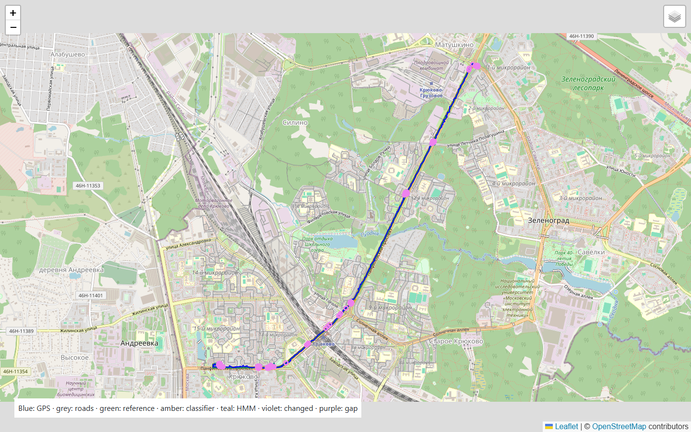

# PathSnap - GPS map matching and route reconstruction

## Team 23

| USN | Name |
|---|---|
| PES1UG24CS078 | Archana Shivakumar |
| PES1UG24CS079 | Arin Singh |
| PES1UG24CS120 | Catherine D |
| PES1UG24CS121 | Ch Yashwitha |



**Layered route output.** The interactive map keeps the **reference route** (green, ground truth) and the **final HMM-predicted route** (teal) as separate overlays, together with raw GPS fixes (blue) and the classifier-only route (amber). This makes route-quality improvements inspectable instead of hiding them behind a single score. Open the [interactive map example](trained_models/hmm/maps/train_clean_00000003.html) to toggle the layers.

PathSnap converts noisy GPS observations and a per-trip directed road network into a connected, directed route. It is an end-to-end, reproducible map-matching system: exploratory analysis, data-quality checks, route-safe preprocessing, candidate generation, feature engineering, five-model comparison, Bayesian optimisation, Hidden Markov Model (HMM) decoding, FastAPI serving, and an interactive Leaflet/OpenStreetMap UI.

**Final submission:** [15-page technical report](reports/PathSnap_Team23_Final_Report.pdf) | [model and HMM comparison](trained_models/COMPARISON_REPORT.md) | [preprocessing evidence](data_preprocessing/PREPROCESSING_REPORT.md) | [backend API](backend/README.md)

## Final result at a glance

Results below are on the held-out `student_test` partition. The student data was used only for final reporting; it did not choose the model, tune hyperparameters, or tune HMM settings.

| System | Point Top-1 (all fixes) | Route continuity | Reference-route F1 | Route-length mismatch |
|---|---:|---:|---:|---:|
| LightGBM classifier | **86.36%** | 75.68% | 0.7305 | 0.8677 |
| **LightGBM + HMM (final route decoder)** | 84.98% | **85.68%** | **0.8367** | **0.2485** |
| Change from HMM decoding | -1.38 pp | **+10.00 pp** | **+0.1062** | **-0.6192** |

The final route decoder deliberately trades a small amount of independent point accuracy for a substantially more connected route. On the ten held-out trips, the continuity increase has a paired bootstrap 95% interval of **+6.12 to +13.59 percentage points**. The complete definitions, per-trip outcomes, and caveats are in [the comparison report](trained_models/COMPARISON_REPORT.md).

## Repository guide

```text
PathSnap/
|- Dataset/                         # 80 training trips and 10 held-out student-test trips
|- data_preprocessing/
|  |- data_analytics/               # EDA notebook, maps, figures, and data-quality outputs
|  |- data_preprocessing/           # projection, labels, candidates, features, pipeline tests
|  `- cleaned_data/                 # reproducible model-ready tables and validation artefacts
|- trained_models/
|  |- model1 ... model5/            # Logistic Regression, KNN, RF, LightGBM, shallow MLP
|  |- model4/tuning/                # Optuna Bayesian-optimisation record
|  |- final_model/                  # frozen, selected LightGBM model and 22-feature contract
|  |- hmm/                          # Viterbi decoder, frozen configuration, maps, diagnostics
|  `- comparison/                   # figures, bootstrap comparisons, and result tables
|- backend/
|  |- api/                          # public REST API inventory and endpoint contract
|  `- app/                          # FastAPI app, inference pipeline, scoring, job manager
|- frontend/                        # dependency-free Leaflet/OpenStreetMap evaluator UI
|- docs/images/                     # README map visual
`- reports/                         # final PDF submitted by Team 23
```

## Data discipline and evaluation protocol

Each trip supplies a GPS track (`.track`), directed road-network nodes (`.nodes`), directed arcs (`.arcs`), and a reference arc sequence (`.route`). Road-network arc IDs are local to a trip; they are never treated as global class labels.

| Partition | Trips | GPS fixes | Purpose |
|---|---:|---:|---|
| `Dataset/train` | 80 | 208,417 | Feature design, grouped cross-validation, model training, HMM search |
| `Dataset/student_test` | 10 | 19,160 | Frozen final evaluation and report only |
| `evaluator_test` | kept local and ignored | - | Demo/evaluator data; never used for training or tuning |

Leakage controls are built into the workflow:

- Cross-validation uses **five trip-grouped folds**, so fixes from one route cannot occur in both training and validation folds.
- UTM projection, scaling bounds, class weights, feature choices, and HMM configuration are fit from training data only and saved as configuration artefacts.
- The inference path consumes only `.track`, `.nodes`, and `.arcs`; it never reads a reference route or calls the label-generation routine. Assertion tests check this contract.
- The API does not expose labels or ground truth to the browser. The UI displays predictions, diagnostics, and aggregate scoring produced server-side.

## 1. Exploratory data analysis (EDA)

The EDA established the data properties before any model was trained. It covers trajectory geography, sampling intervals, gaps, GPS step length/speed, road-network size and connectivity, candidate density, label distance, and class/feature distributions. The executed notebook and committed figures are under `data_preprocessing/data_analytics/`.

Key observations that directly changed the pipeline:

- Trips span **25 UTM zones** and longitude -100 to 137 degrees. Latitude/longitude cannot be used directly for metre-distance calculations, so each trip is projected independently to its appropriate UTM coordinate system.
- GPS sampling is near 1 Hz (99.1% of training steps and 99.9% of student-test steps are one second), but long gaps do occur: 1,216 in training and 44 in student-test using the `> 5 s` threshold.
- The road topology is directed and mostly connected, while 92.2% of arcs have a reverse-direction counterpart. Direction and connectivity therefore matter; nearest-road matching alone is insufficient.
- Some supplied reference routes do not cover the complete GPS trajectory. This creates far labels and explains much of the train candidate miss rate. Far observations are retained for reporting but down-weighted/excluded from classifier fitting as appropriate.
- Distance-to-arc and arc-length distributions are right-skewed; the preprocessing stores robust diagnostics and applies justified log/winsor transforms where needed.

## 2. Data preprocessing and label construction

The reusable preprocessing implementation is in `data_preprocessing/data_preprocessing/pathsnap_prep.py`; its fixed thresholds and feature schema live in `preprocessing_config.json`.

1. **Schema validation and ordering.** Track, node, arc, and route files are parsed with explicit schemas. Invalid coordinates, duplicate/non-monotonic timestamps, and index-space mistakes are checked; no rows were dropped by the training drop rule.
2. **Metric coordinate projection.** Longitude/latitude are projected per trip to UTM. Arc geometries, lengths, bearings, node in/out degree, reverse-twin relationships, and spatial indices are then computed in metres.
3. **GPS-quality diagnostics.** Per-fix flags record stationary movement, GPS hives, fixes after a long gap, speed jumps, and robust speed outliers. These are diagnostics/features, not indiscriminate row deletion.
4. **Route-position Viterbi labels.** A `.route` file contains an ordered arc sequence, not a label for every GPS fix. A monotone Viterbi alignment assigns each fix to a feasible route position and handles loops correctly. This avoids the failure mode of a greedy nearest-route labeler.
5. **Label-quality weights.** Points are classified as clean (weight 1.0), ambiguous (0.5), or far (0.3). A far label is never silently replaced by the nearest road.
6. **Route-free candidate generation.** An STRtree retrieves arcs within 50 m. If fewer than two candidates are found, the search expands to 100 m; if needed, the five nearest arcs are used. At most 50 candidates are kept. Every GPS fix has at least one candidate.

The resulting candidate set averages 9.3 arcs/fix in training and 10.8 in student-test. Candidate coverage imposes a hard upper limit on Top-1 accuracy: a reference arc cannot be selected when it is not a candidate. The final candidate miss rate is 10.37% in training (mostly uncovered far labels) and 0.15% in student-test.

## 3. Feature engineering, selection, and reduction

We initially engineered 26 route-free candidate features. They describe geometry, relative rank, heading, movement, local temporal context, and graph topology; no feature uses the true route at inference time.

| Feature family | Retained examples | Why it helps |
|---|---|---|
| Geometry and position | `dist_m`, `frac`, distance to arc start/end, `log_arc_len` | Distinguishes nearby roads and where a projection falls on an arc |
| Candidate-set context | `rank`, `dist_minus_nearest`, `n_candidates`, `is_nearest` | Represents local ambiguity rather than distance alone |
| Direction | arc bearing, `heading_sin`, `heading_cos`, heading-valid flag, reverse-twin flag | Separates opposite carriageways and direction of travel |
| Motion and time | `speed_mps`, `after_gap`, `stationary` | Makes the model robust to pauses and irregular sampling |
| Neighbourhood and topology | previous/next/window distance, arc in/out degree | Captures local trajectory continuity and road structure |

Continuous features are winsorised using training 1st/99th percentiles; distances to arc ends use `log1p`; scaled copies are used for linear, KNN, and MLP models. Tree models consume the raw feature table. The final contract contains **22 selected features** (17 continuous and 5 binary), saved with the model so backend inference uses exactly the training schema.

### Evidence-based reduction: 26 -> 22 features

| Removed feature | Evidence | Retained alternative / decision |
|---|---|---|
| `heading_diff_abs` | Perfect monotonic collinearity with `heading_cos`; equal AUC edge | Keep directional `heading_cos` |
| `is_two_way` | Spearman rho = 0.999 and VIF = 575.9 with reverse-twin status | Keep `is_reverse_twin` |
| `gap_len_s` | Redundant with `after_gap`, extremely skewed (about 229) | Keep the stable binary gap indicator |
| `in_hive` | 99.8% of values are the same; AUC approximately 0.50 | Drop near-constant noise |

This reduction is intentional rather than a search for the largest possible feature count: it removes redundant and near-constant inputs while preserving complementary signals and model interactions.

## 4. Model comparison and selection

All five model families receive the same candidate-level labels, 22 selected features, sample weights, and trip-grouped folds.

| Model | Family | Student Top-1 | Student macro F1 | Normalised log loss |
|---|---|---:|---:|---:|
| Logistic Regression | linear / probabilistic baseline | 83.26% | 0.9081 | 0.7357 |
| KNN | instance-based | 84.28% | 0.9138 | 0.7614 |
| Random Forest | bagging ensemble | 84.47% | 0.9148 | 0.4462 |
| **LightGBM** | gradient boosting | **86.36%** | **0.9252** | **0.4018** |
| Shallow MLP | neural network | 85.93% | 0.9229 | 0.4076 |

LightGBM and the shallow MLP were effectively tied on primary cross-validation Top-1; LightGBM was selected because it had the best held-out classifier metrics, compact/fast inference, calibrated non-zero emissions for route decoding, and robust feature-interaction handling. The decision rule was written before student-test reporting: primary metric is grouped-CV all-point Top-1 with normalised log loss for near-ties, not training accuracy.

## 5. Bayesian hyperparameter optimisation

`trained_models/model4/tuning/` contains the Optuna Bayesian/TPE study, trial export, best-parameter record, and notebook. The search varied LightGBM learning rate, number of leaves, tree depth, minimum leaf size, feature fraction, bagging fraction, L1/L2 regularisation, and minimum split gain.

- **Objective:** mean in-candidate Top-1 over the stored trip-grouped folds; normalised log loss resolves near ties.
- **Decision rule:** deploy a tuned model only if its 95% trip-bootstrap gain interval is positive and its normalised log loss is no worse.
- **Outcome:** the tuned in-candidate CV gain interval was [-0.00149, +0.00269], which includes zero. We therefore kept the smaller, faster **untuned LightGBM** as the frozen final classifier rather than claiming an unreliable tuning gain.
- **Audit note:** the narrative records 41 unique completed configurations / 46 completed evaluations; the exported study also contains a small unresolved record-count discrepancy (47 `COMPLETE`, 3 `FAIL`). The original decision was not recomputed after this audit finding.

## 6. HMM/Viterbi route reconstruction

Independent candidate predictions can jump between parallel or disconnected road segments. The HMM uses the classifier as an emission model and the road network as a sequence constraint:

- **Hidden state:** a directed candidate road arc for each GPS observation.
- **Emission:** per-point LightGBM candidate probabilities, normalised, floored, logged, and weighted.
- **Transition:** compatibility between directed network distance and observed GPS displacement, with a reverse/U-turn penalty.
- **Gaps and missing candidates:** real elapsed time relaxes transition scale after a gap; the decoder carries/restarts safely when required.
- **Decoder:** Viterbi dynamic programming with frozen settings (`alpha=2`, `beta=30 m`, U-turn penalty `2`, top-k `15`).

This is why the HMM can reduce broken transitions from **1,334 to 656** on student-test and make the path much more route-like even when its per-point Top-1 is slightly lower. It does not use reference-route labels in the API inference path.

### Why accuracy is not 100% - and why continuity is a separate metric

Point Top-1 asks: *did the highest-scoring arc at this GPS fix equal the reference label?* Continuity asks: *are consecutive, deduplicated predicted arcs connected in the directed road network?* They answer different questions.

- GPS noise, nearby/parallel roads, opposite directions, and intermittent observations can make one point genuinely ambiguous.
- Some reference routes do not fully cover the measured GPS trace, so the correct reference arc can be absent from the candidate set.
- Fast/sparse steps can skip short road arcs; no point-level method can observe every unrecorded traversal.
- The HMM may replace an isolated locally plausible arc with a connected neighbour. That can lower independent point accuracy while producing the physically coherent route required for map matching.

## 7. Backend API and frontend map

The deployment components are deliberately small and inspectable:

| Component | Responsibility |
|---|---|
| `backend/app/` | FastAPI lifecycle, model loading, preprocessing/inference stages, HMM adapter, scoring, jobs, structured logs |
| `backend/api/` | Canonical public route inventory for `/api/health`, `/api/trips`, `/api/predict`, `/api/jobs/{id}`, and `/api/logs` |
| `frontend/` | Static, dependency-free interface with connection controls, status, metrics, error summary, exports, API activity drawer, and Leaflet map |
| `frontend/js/map.js` | Uses direct OpenStreetMap tiles with visible attribution; draws GPS, classifier, HMM, gaps, stationary fixes, and changed points as separate toggles |

The backend exposes OpenAPI documentation at `http://localhost:8000/docs` while running. Reference routes and per-point correctness are deliberately not rendered in the public evaluator UI; the versioned Folium artefacts are used for offline report inspection.

## Run locally

Requirements: Python 3.10+ (verified with Python 3.12) and an internet connection for OpenStreetMap map tiles. The frontend is plain HTML/CSS/JavaScript - no Node or build step is required.

```bat
:: Terminal 1 - backend
cd backend
python -m venv .venv
call .venv\Scripts\activate
pip install -r requirements.txt
copy .env.example .env
start_backend.bat
```

```bat
:: Terminal 2 - frontend
cd frontend
python -m http.server 5500
```

Open `http://localhost:5500`, leave the local backend URL as `http://localhost:8000`, and press **Connect**. For a two-laptop demo, expose port 8000 with `ngrok http 8000`, paste the HTTPS URL into the UI, and use **Test connection**. The UI adds the ngrok warning-skip header automatically.

Useful validation commands:

```bat
cd data_preprocessing\data_preprocessing
pytest test_pipeline.py -q

cd ..\..\backend
pytest -q
```

## Deliverables and reproducibility trail

- [Final technical report (PDF)](reports/PathSnap_Team23_Final_Report.pdf)
- [Data analysis and preprocessing report](data_preprocessing/PREPROCESSING_REPORT.md)
- [Final model/HMM comparison with bootstrap intervals](trained_models/COMPARISON_REPORT.md)
- [Frozen 22-feature model contract](trained_models/final_model/config.json)
- [Bayesian-optimisation study records](trained_models/model4/tuning/)
- [HMM configuration](trained_models/hmm/config.json) and [interactive route maps](trained_models/hmm/maps/)
- [Backend setup and REST endpoints](backend/README.md) and [frontend usage](frontend/README.md)


---

The project is submitted as an evidence trail rather than a black box: every preprocessing threshold, feature decision, model comparison, tuning record, HMM setting, evaluation definition, map, and deployment endpoint is available in this repository.
